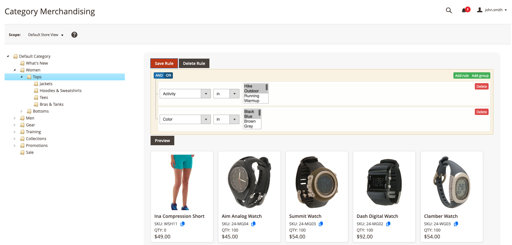
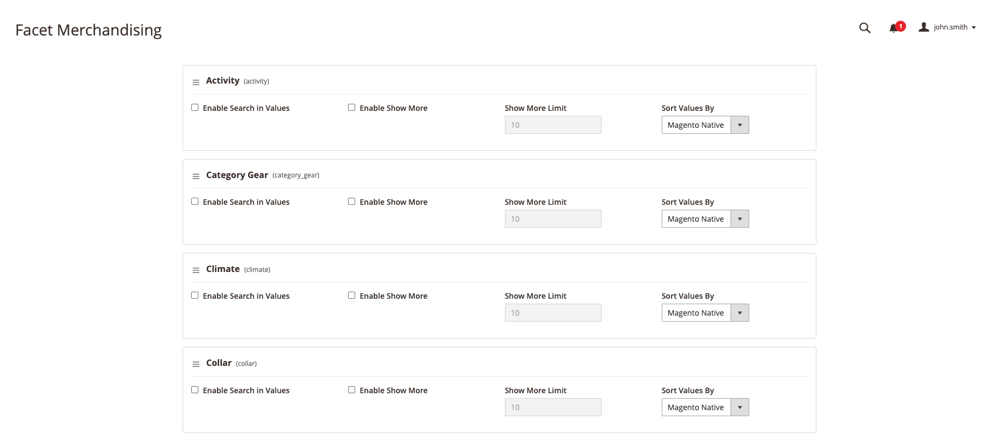

# <p align="center">Meilisearch / Magento 2 (Adobe Commerce)</p>

<p align="center">
    <a href="https://walkwizus.github.io/magento2-module-meilisearch-docs/">
        
    </a>
    <a href="https://demo-meilisearch.walkwizus.com/">
        
    </a>
</p>

<p align="center">
    
    
    &nbsp;&nbsp;&nbsp;&nbsp;
    
    
</p>

The Meilisearch extension for Magento 2 enables replacing Magento's default search engine (OpenSearch) with Meilisearch.

## 🔎 What is Meilisearch?

Meilisearch is a search engine featuring a blazing fast RESTful search API, typo tolerance, comprehensive language support, and much more.

## ⚙️ Installation & Requirements

> [!IMPORTANT]
> **Meilisearch PHP SDK Dependency** > This module **no longer includes the Meilisearch PHP SDK automatically**. You must install it manually in your project.  
> The module requires **Meilisearch PHP SDK version `>= 2.0.0-beta.8`**.
>
> ```bash
> composer require "meilisearch/meilisearch-php:^2.0@beta"
> ```

## 🧩 Hyvä Compatibility

This frontend is fully compatible with the [Hyvä Frontend](https://www.hyva.io/).  
If you're using Hyvä, make sure to install the dedicated compatibility module:  
👉 [Meilisearch Hyvä Compatibility Module](https://github.com/walkwizus/magento2-hyva-meilisearch)

## 🧩 Breeze Compatibility

This frontend is fully compatible with the [Breeze frontend](https://breezefront.com/) by SwissUp.  
If you're using Breeze, make sure to install the dedicated compatibility module:  
👉 [Meilisearch Breeze Compatibility Module](https://github.com/walkwizus/magento2-module-breeze-meilisearch)

## ✨ Main Features

### 🗂️ Category Merchandising

The **Category Merchandising** feature allows you to dynamically populate your categories using a rule engine.  
No more manual category management — products are automatically assigned in real time based on the rules you define.

You retain full control with an intuitive **drag-and-drop** interface to reorder products and highlight your **top-performing items**.

<p align="center">
  
</p>

### 🧩 Facet Merchandising

The **Facet Merchandising** feature lets you fully customize the display of layered navigation filters for an optimized user experience.  
You can:

- 🔃 Reorder facets as needed
- 🔍 Enable a search field within facet options
- 🔎 Enable Fuzzy Search within facet options for approximate matching
- ➕ Limit the number of visible options with a **“Show more”** toggle

Perfect for keeping navigation **clean and user-friendly**, even in **attribute-rich catalogs**.

<p align="center">
  
</p>

### 🖥️ Faceted Frontend Experience

The module offers a **fully dynamic and responsive frontend interface** powered by Knockout.js, designed to enhance layered navigation usability and speed.

Key features include:

- 🎚️ **Price slider** with real-time filtering
- ☑️ **Multi-select checkboxes** for flexible attribute filtering
- 🔍 **Search within facet options** to quickly find relevant values
- 🔎 **Fuzzy search within facet options** for approximate matching powered by Fuse.js
- ⚡ Instant UI updates without page reloads

The search within facet options is powered by [Fuse.js](https://fusejs.io/), providing **fast, fuzzy search** among attribute values directly in the frontend.  
This enhances usability, especially for attributes with a large number of options, by allowing approximate matching and instant filtering.

This modern frontend ensures a smooth and engaging shopping experience, even on large catalogs.

---

<p align="center">
    <b>📚 Documentation &nbsp;&nbsp; | &nbsp;&nbsp; 🚀 Live Demo</b>
</p>

<p align="center">
    <a href="https://walkwizus.github.io/magento2-module-meilisearch-docs/" target="_blank">
        
    </a>
    &nbsp;&nbsp;&nbsp;&nbsp;
    <a href="https://demo-meilisearch.walkwizus.com/" target="_blank">
        
    </a>
</p>

<p align="center">
    <a href="https://walkwizus.github.io/magento2-module-meilisearch-docs/" target="_blank">View the full documentation</a> &nbsp;&middot;&nbsp; 
    <a href="https://demo-meilisearch.walkwizus.com/" target="_blank">Try the live demo</a>
</p>
